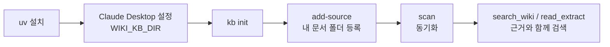

# wiki-mcp

LLM Wiki를 [MCP](https://modelcontextprotocol.io/) 도구로 노출하는 서버입니다.
현재 버전 **0.3.0**. 한국어 원자 노트 wiki를 만들고 검색하고, **KB 모드**를
켜면 내 문서 폴더(HWPX·DOCX·PDF·XLSX 등)를 **그대로 둔 채** 근거와 함께
검색할 수 있습니다.

- 검색: BM25 + (선택) dense 임베딩 RRF 하이브리드, 한국어 글자 2-gram
- 노트: `[[id]]` 링크 그래프, 템플릿, 백업·dry-run 안전장치가 있는 쓰기 도구
- KB 모드(0.3.0 신규): 원본 폴더를 읽기만 하고 추출 결과를 지식 기반에 쌓는
  원본 보존 구조 — [docs/kb-mode.md](docs/kb-mode.md)

## 설치

### 1. uv 설치

모든 OS에서 [astral.sh/uv](https://docs.astral.sh/uv/getting-started/install/)로:

**macOS / Linux**

```bash
curl -LsSf https://astral.sh/uv/install.sh | sh
```

**Windows (PowerShell)**

```powershell
powershell -ExecutionPolicy ByPass -c "irm https://astral.sh/uv/install.ps1 | iex"
```

### 2. Claude Desktop 설정

설치 명령은 한 줄이다 — `uvx`가 저장소에서 받아 실행한다.

**Windows** — `%APPDATA%\Claude\claude_desktop_config.json`
(macOS: `~/Library/Application Support/Claude/claude_desktop_config.json`)

KB 모드(원본 폴더 검색):

```json
{
  "mcpServers": {
    "wiki": {
      "command": "uvx",
      "args": ["--from", "git+https://github.com/yarang/wiki-mcp@v0.3.0", "wiki-mcp"],
      "env": {
        "WIKI_KB_DIR": "C:\\Users\\이름\\personal-kb",
        "EMBEDDING_DISABLED": "1"
      }
    }
  }
}
```

기존 방식(내 wiki 폴더만 — 0.2.4와 같은 동작):

```json
{
  "mcpServers": {
    "wiki": {
      "command": "uvx",
      "args": ["--from", "git+https://github.com/yarang/wiki-mcp@v0.3.0", "wiki-mcp"],
      "env": {
        "WIKI_PATH": "C:\\Users\\이름\\my-wiki",
        "WIKI_DATA_DIR": "C:\\Users\\이름\\my-wiki\\.index",
        "EMBEDDING_DISABLED": "1"
      }
    }
  }
}
```

`EMBEDDING_DISABLED=1`이면 임베딩 서버(Ollama·LM Studio) 없이 BM25 전용으로
동작합니다. 처음엔 이걸 권장합니다.

설정 후 Claude Desktop을 재시작하면 도구가 붙습니다.

## KB 모드 사용법



명령줄에서 KB를 만들고 원본 폴더를 등록한다(데스크톱 앱이 같은 CLI를 부른다 —
[CLI JSON 계약](docs/cli-contract.md)):

```bash
uvx --from git+https://github.com/yarang/wiki-mcp@v0.3.0 wiki-mcp kb init --kb ~/personal-kb
uvx --from git+https://github.com/yarang/wiki-mcp@v0.3.0 wiki-mcp kb add-source --kb ~/personal-kb ~/Documents/강의자료
uvx --from git+https://github.com/yarang/wiki-mcp@v0.3.0 wiki-mcp kb scan --kb ~/personal-kb
```

원본 폴더에는 한 글자도 쓰지 않는다. 모든 기록은 `~/personal-kb` 안에 있다.
민감해 보이는 폴더 이름(`급여`, `인사`, `.ssh` 등)은 경고 후 확인(`--confirm`)을
요청한다.

Claude에서는 이렇게 쓴다:

- "출장비 정산 기준 찾아 줘" → `search_wiki`(노트+원본 함께, 원본 결과는
  파일·페이지·섹션 위치와 함께)
- "그 문서 원문 좀 보여 줘" → `read_extract`(원본 근거 조각 읽기)
- "새 자료 폴더 하나 더 등록해 줘" → `add_source` → `scan_sources`

구조·상태 코드·제약은 [docs/kb-mode.md](docs/kb-mode.md) 참고.

## CLI (데스크톱 앱용)

인자 없이 실행하면 MCP 서버(stdio), `kb` 하위 명령은 JSON을 돌려준다:

```
wiki-mcp kb init --kb DIR
wiki-mcp kb add-source --kb DIR PATH [--include GLOB]... [--exclude GLOB]... [--confirm]
wiki-mcp kb remove-source --kb DIR ID
wiki-mcp kb list-sources --kb DIR
wiki-mcp kb scan --kb DIR
wiki-mcp kb status --kb DIR
```

stdout에는 JSON을 정확히 한 줄(UTF-8 고정), 로그는 stderr. 종료 코드:
0 성공 · 1 입력 오류 · 2 내부 오류 · 3 경고(민감 폴더 확인 대기).
전체 계약은 [docs/cli-contract.md](docs/cli-contract.md).

## 환경 변수

| 변수 | 기본값 | 설명 |
| --- | --- | --- |
| `WIKI_KB_DIR` | (없음) | KB 모드 켜기. 정하면 `WIKI_PATH`·`RAW_DIR`·`DATA_DIR` 기본값이 KB 안으로 잡힌다 |
| `WIKI_PATH` | KB 모드면 `<KB>/wiki`, 아니면 저장소 예제 wiki | 노트 폴더 |
| `WIKI_DATA_DIR` | KB 모드면 `<KB>/.kb/index` | 색인·캐시 데이터 |
| `WIKI_TEMPLATE_DIR` | `<wiki>/.templates` | 노트 템플릿 폴더 |
| `WIKI_DEFAULT_TEMPLATE` | (없음) | create_note 기본 템플릿 이름 |
| `EMBEDDING_DISABLED` | (끔) | `1`이면 BM25 전용 — 임베딩 서버 불필요 |
| `OLLAMA_URL` | `http://localhost:11434` | 임베딩 엔드포인트(OpenAI 호환 포함) |
| `EMBEDDING_MODEL` | `bge-m3` | 임베딩 모델 |
| `EMBEDDING_PROVIDER` | `ollama` | `ollama`(\|api/embeddings) 또는 `openai`(\|v1/embeddings, LM Studio 포함) |
| `EMBEDDING_API_KEY` | (없음) | 호스팅 임베딩 제공자용 키 |
| `WIKI_RAW_DIR` | `<wiki 상위>/raw` | (기존 모드) raw 원문 폴더 |
| `WIKI_INGEST_ENABLED` | (끔) | (기존 모드) raw → 노트 자동 변환 |
| `WIKI_INGEST_URL`·`_MODEL`·`_API_KEY`·`_TIMEOUT` | — | (기존 모드) OpenAI 호환 변환 LLM |
| `WIKI_INGEST_EXT` | `.txt,.md,…,.jpg` | (기존 모드) 취급 확장자 |
| `WIKI_INGEST_OCR` | `1` | 스캔 PDF·이미지 OCR 폴백(macOS만) |
| `WIKI_INGEST_OCR_BIN` | (없음) | OCR 바이너리 경로 — **0.3.0부터 환경 변수로만** 받는다 |
| `WIKI_KB_MAX_EXTRACT_CHARS` | `200000` | KB 추출 결과 상한(문자) |
| `WIKI_MCP_TRANSPORT` | `stdio` | `stdio` 또는 `http`(원격 daemon) |
| `WIKI_MCP_HOST`·`_PORT`·`_PATH` | `127.0.0.1:8765/mcp` | HTTP 전송 설정 |
| `WIKI_MCP_API_KEY` | (없음) | HTTP 전송 Bearer 토큰 — 원격 노출 시 필수 |

## 도구 (KB 모드: 22종)

기존 15종(0.2.4와 동일): `search_wiki` `read_note` `find_related`
`list_domains` `find_broken_links` `suggest_new_note` `get_wiki_stats`
`verify_citations` `reindex` `create_note` `ingest_raw` `list_templates`
`update_note` `add_link` `delete_note`

KB 모드 추가 7종(설명 첫 줄에 [읽기]/[쓰기]/[관리] 표시):

| 도구 | 구분 | 일 |
| --- | --- | --- |
| `add_source` | [관리] | 원본 폴더 등록(민감 이름 경고) |
| `list_sources` | [읽기] | 등록된 원본 목록 |
| `remove_source` | [관리] | 원본 등록 제거(원본 무사) |
| `scan_sources` | [관리] | 결정적 스캔 — 새/바뀜/지움 추출 |
| `list_changes` | [읽기] | 마지막 스캔 변경 목록(상태 필터) |
| `read_extract` | [읽기] | 원본 추출 결과 조각 읽기(offset/limit) |
| `kb_status` | [읽기] | 원본별 파일 수·실패 목록·마지막 스캔 |

`search_wiki`는 `scope`(`all`/`notes`/`sources`) 인자를 받는다. KB 모드가
아니면 이 인자는 무시된다.

## 개발

```bash
git clone https://github.com/yarang/wiki-mcp && cd wiki-mcp
uv venv && uv sync --extra dev --extra docs   # 문서 추출 라이브러리 포함
uv run --extra dev ruff check .
uv run --extra dev ruff format --check .
uv run --extra dev pytest -q        # chromadb 없이 통과 (chromadb 테스트는 skip)
```

- `uv sync --extra dev`만 하면 chromadb·문서 추출 라이브러리 없이 돌아간다
  (해당 테스트는 자동 skip).
- CI: Windows·macOS 행렬([.github/workflows/ci.yml](.github/workflows/ci.yml)).

### 의존성 구성

| extra | 내용 | 없으면 |
| --- | --- | --- |
| (기본) | MCP 서버·BM25·노트 쓰기 | — |
| `embed` | chromadb — dense 임베딩 검색 | BM25 전용으로 동작(stderr에 안내 한 줄) |
| `docs` | pypdf·docx2txt·python-pptx·openpyxl·beautifulsoup4 | 해당 형식 추출이 `failed`로 기록된다 |
| `dev` | pytest·ruff·build | — |

### 소스 구성

```text
src/wiki_mcp/
├── server.py      # FastMCP 서버 — 도구 정의/등록 (KB 모드: 22종)
├── cli.py         # 진입점 — 인자 없으면 MCP, `kb` 하위 명령은 JSON CLI
├── indexer.py     # 인덱싱 + 하이브리드 검색 (한글 2-gram, chromadb 지연 로딩)
├── kb/            # KB 모드 (0.3.0): store·sources·scanner·chunks·search·status
├── extract.py     # 문서 추출 (PDF/DOCX/PPTX/XLSX/HTML/HWPX) + 위치 표지
├── graph.py       # [[id]] 링크 그래프
├── writer.py      # 노트 생성·수정·삭제 (검증·백업·템플릿)
├── ingest.py      # (기존 모드) raw 원문 → 노트 변환 (LLM)
├── watch.py       # (기존 모드) raw 폴더 감시
├── autoindex.py   # 노트 변경 감지 → 자동 재인덱싱
├── config.py      # 환경 변수 / 경로 해석
└── auth.py        # HTTP 모드 Bearer 인증
```

## 이전 번들(openwebui-wiki-bundle) 사용자 안내

이 저장소는 Open WebUI 번들에 들어 있던 wiki-mcp 0.2.4를 분리한 독립
저장소다. 번들 환경에서:

- 기존 환경 변수(`WIKI_PATH`, `WIKI_RAW_DIR`, `WIKI_INGEST_*`, …)와 도구
  15종, `ingest_raw`·raw 폴더 감시 동작은 그대로다.
- `WIKI_KB_DIR`을 설정하지 않으면 KB 모드는 켜지지 않는다.
- **chromadb가 기본 의존성에서 빠졌다** — 번들처럼 dense 검색이 필요하면
  `wiki-mcp[embed]`으로 설치하면 이전과 같다(설치 안 해도 BM25 전용으로
  동작).
- 문서 추출 라이브러리(pypdf 등)는 `[docs]` extra로 옮겼다. 번들은
  `wiki-mcp[embed,docs]`로 설치 권장.
- OCR 바이너리 경로는 이제 `WIKI_INGEST_OCR_BIN` 환경 변수로만 받는다
  (번들 폴더 구조 가정 제거).

## 라이선스

MIT — [LICENSE](LICENSE).
