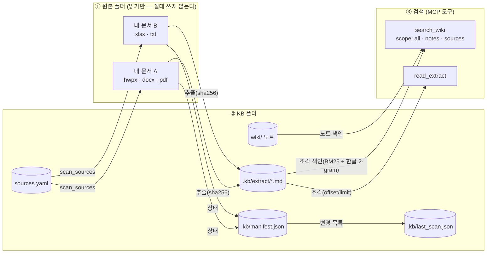

# KB 모드 — 원본 보존 지식 기반 (0.3.0)

> 대상: wiki-mcp 0.3.0 사용자·데스크톱 앱 개발자.
> 관련 문서: [README](../README.md) · [CLI JSON 계약](cli-contract.md).
> 설계 배경: Workflow Manager 문서 `personal-wiki.md` 3장(구조)·7장(변경 요청).

## 1. KB 모드란

`WIKI_KB_DIR`(또는 CLI `--kb`)로 지식 기반 폴더를 정하면 켜진다. 내 문서
폴더(HWPX·DOCX·PDF·XLSX 등)를 **그대로 둔 채** wiki-mcp가 검색하게 만드는
수업용 모드다. 기존 동작(번들: `ingest_raw`, raw 폴더 감시, 도구 15종,
환경 변수)은 KB 모드를 끄면 0.2.4와 같다.

**원본 보존 약속**

- 원본 폴더는 읽기만 한다. 스캔·추출·삭제 어느 경로에서도 쓰지 않는다.
- 모든 산출물(매니페스트·추출 결과·노트·색인)은 KB 폴더 안에 있다.
- KB 폴더를 지우면 원본에는 흔적이 없다. 처음 상태로 돌아간다.
- 이 보증은 테스트로 고정돼 있다(`test_kb_scan.py::TestOriginalPreservation`).

## 2. 폴더 구조

```text
<KB>/
├─ sources.yaml        # 원본 폴더 목록: id, path(절대), include/exclude glob, added_at
├─ .kb/
│  ├─ manifest.json    # 파일별: source_id, rel_path('/' 구분, NFC), size, mtime,
│  │                   #   sha256, status, reason, extract_id, title, scanned_at
│  ├─ extract/<sha256 앞 32자>.md   # 추출 결과 (같은 내용 파일끼리 공유)
│  ├─ last_scan.json   # 마지막 스캔 결과와 변경 목록
│  ├─ scan.lock        # 스캔 동시 실행 방지 (10분 넘으면 무시)
│  └─ index/           # 색인 데이터(임베딩 사용 시)
└─ wiki/               # 노트 — 기존 WIKI_PATH 역할(KB 모드 기본값)
```

## 3. 구조와 흐름



스캔 흐름(`scan_sources`, 결정적 — LLM·네트워크 없음):

```mermaid
flowchart TD
    A[scan_sources] --> L{scan.lock<br/>활성 잠금?}
    L -- 있음 --> E1[error: scan_in_progress]
    L -- 없음/10분 경과 --> W[원본 폴더 순회<br/>숨김·심볼릭 링크 밖·임시 파일 제외]
    W --> U{mtime 2초 미만?}
    U -- 있음 --> SKIP[이번 생략<br/>다음 스캔에 다시]
    U -- 아니오 --> H{size·mtime 같음?}
    H -- 같음 --> HASH[sha256 생략·재사용]
    H -- 다름 --> HASH2[sha256 계산]
    HASH & HASH2 --> V{판정}
    V -- new/changed --> X[추출 시도]
    V -- unchanged --> OK0[유지]
    X -- 성공 --> EXF[extract/&lt;sha&gt;.md<br/>있으면 공유(재추출 생략)]
    X -- 실패 --> FAIL[failed + reason 코드]
    V -- 사라짐 --> DEL[deleted · 참조 없는 추출 제거]
    EXF & OK0 & FAIL & DEL --> M2[manifest.json · last_scan.json 저장]
```

## 4. 상태·사유 코드

manifest 항목의 `status`:

| status | 뜻 |
| --- | --- |
| `ok` | 추출 성공 |
| `failed` | 추출 실패 — `reason` 참고 |
| `deleted` | 원본에서 사라짐(항목은 스캔 때 정리된다) |

`failed`의 `reason` 고정 코드:

| reason | 조건 |
| --- | --- |
| `unsupported` | 지원 밖 형식(`.hwp` 바이너리 등 — 사용자 안내용으로만 기록) |
| `too_large` | 50MB 초과 |
| `encrypted` | 암호로 보호된 문서 |
| `corrupt` | 깨진 파일·zip·XML, 알 수 없는 인코딩(utf-8/cp949 모두 실패) |
| `empty_text` | 텍스트를 얻지 못함(스캔본 PDF, 빈 문서) |
| `locked` | 파일 잠김(Windows 공유 위반 등) |
| `extract_error` | 그 밖의 추출기 오류 |

지원 형식: `.md` `.txt` `.csv`(텍스트, utf-8 → cp949 순서), `.pdf` `.docx`
`.pptx` `.xlsx` `.html`/`.htm`, **`.hwpx`**. 그 외 확장자는 조용히 무시하고,
`.hwp`만 `failed(unsupported)`로 기록해 안내한다.

실패 원문 문자열·파일 내용은 manifest에 넣지 않는다(stderr 로그에 경로
정도만). 스캔 중 수정 중인 파일(mtime 2초 미만)은 이번 회차에서 건너뛰고
다음 스캔에 다시 본다.

## 5. 검색 통합

KB 모드의 색인은 **wiki 노트 + 원본 추출 조각**을 함께 담는다. 추출 결과는
위치 표지(`<!-- page 3 -->`, `<!-- slide 2 -->`, `<!-- sheet 이름 -->`,
`<!-- section 0 -->`)와 제목 경계로 약 1,500자 이하 조각으로 나뉜다.

`search_wiki`의 `scope` 인자:

| scope | 범위 |
| --- | --- |
| `all`(기본) | 노트 + 원본 조각(RRF 병합) |
| `notes` | 노트만(기존 동작) |
| `sources` | 원본 조각만 |

원본 결과는 `kind: "source"`와 함께 `source_id`, `rel_path`, `location`
(위치 표지), 원본 절대 경로(`path`), 조각 `snippet`을 돌려준다. 본문 전체는
`read_extract(source_id, rel_path, offset, limit=8000)`로 조각 단위로 읽는다
— manifest에 등록된 항목만 읽을 수 있다(경로 이탈 금지).

한국어 검색은 인덱서의 글자 2-gram("기준" → "기준을" 매칭)이 노트·원본
양쪽에 같이 적용된다.

## 6. 서버 시작 동작

KB 모드로 서버를 띄우면:

- **스캔은 자동으로 돌리지 않는다.** 사용자(또는 앱)가 `scan_sources` 도구·
  `wiki-mcp kb scan`으로 동기화한다.
- 색인은 **기존 추출 결과**(`.kb/extract/`)로 만든다. 처음엔 비어 있다.
- KB 폴더가 초기화돼 있지 않으면(`sources.yaml` 없음) KB 도구 없이 기존
  15종만 뜬다 — `wiki-mcp kb init`을 먼저 실행하라는 안내가 stderr에 나온다.

## 7. 제약

- `.hwp`(바이너리)는 지원하지 않는다 — 한컴오피스에서 `.hwpx`로 다른 이름으로
  저장하면 된다.
- 스캔 PDF의 OCR 폴백은 macOS(Apple Vision `vision-ocr` 바이너리)에서만
  동작한다. `WIKI_INGEST_OCR_BIN`으로 경로를 지정한다(0.3.0부터 환경 변수로만
  받는다). Windows에서 스캔 PDF는 `empty_text`로 기록된다.
- 50MB 초과 파일, 암호 문서는 추출하지 않는다.
- 원본 폴더의 파일을 수동으로 고쳐도 다음 스캔 전까지 색인에는 반영되지
  않는다(스캔은 명시적 동작이다).
